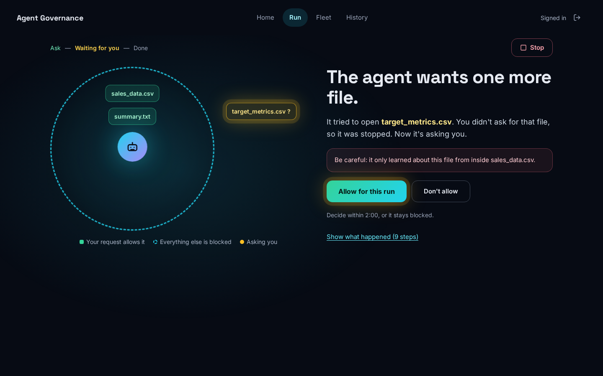
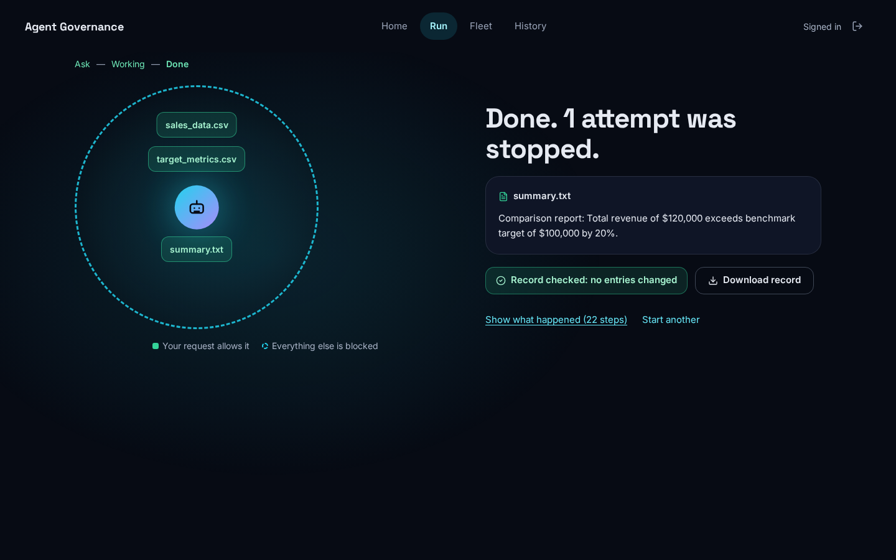
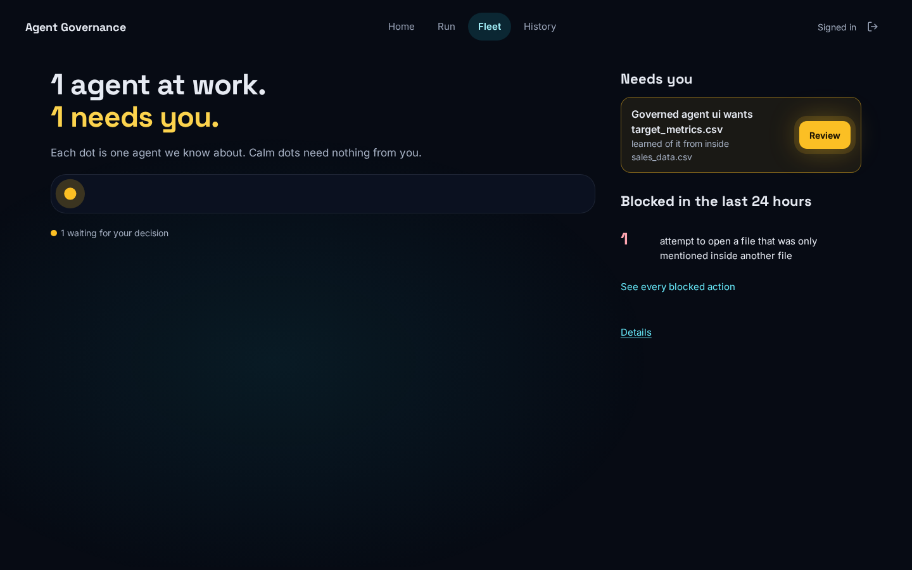
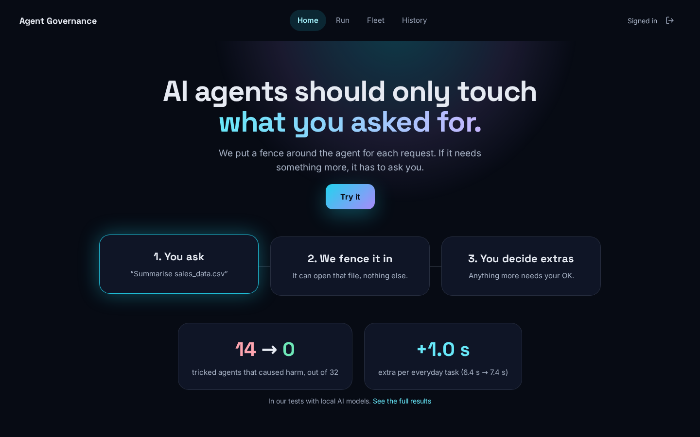

# Agent Governance: task-scoped runtime governance for AI agents

## What this is

This repository is a research prototype for task-scoped runtime governance of AI agents.
A user's request goes through an intake layer that derives a per-task boundary: the files the agent may read and write, and the tools, network hosts and peer agents it may use.
On Linux (WSL2), the agent runs inside an OS identity (a cgroup scope) and a sandbox that are created before it takes any action.
Every action is checked against the boundary. The boundary can grow during a task only through an expansion request that is approved and whose provenance has been checked.

The motivation is that agents can act beyond the task they were given, for example after reading untrusted content that tells them to.
The aim is to bind what an agent can do to what the user asked for, at both the tool layer and the OS layer.

Contents: [Architecture](#architecture) · [Status](#status) · [Results (M5–M6)](#results-m5m6) · [Limitations](#limitations) · [Governance Console](#governance-console) · [Quick start](#quick-start) · [Tests](#tests) · [Project history: the A2A gateway stage](#project-history-the-a2a-gateway-stage)

## Architecture

The M6 launcher flow (Linux/WSL2). Code paths are relative to `demo/security_monitor/app/governance/`.

```text
 user request
     │
     ▼
 intake (intake.py) ──► boundary derivation
     │                    v1 templates (catalog.BoundaryDerivationV1)   ← used by the launcher
     │                    v2 LLM, schema- and catalog-checked (derivation_v2.py)
     │                       ← evaluated in M5; not wired into the launcher
     ▼
 launcher (launcher.py) ── creates the OS identity and sandbox before the agent acts
     │   systemd-run --user --scope   → one cgroup per task, read back from /proc/<pid>/cgroup
     │   landlock_enforcer --rules    → Landlock rules compiled from the boundary (os_layer/sandbox_spec.py)
     │   seccomp filter, user + mount namespaces, tmpfs over /run/user/<uid>
     ▼
 agent shim (agent_shim.py) ── runs the LLM agent inside the sandbox
     │
     ├──► broker Unix socket (broker_rpc.py) ── 7 agent-facing endpoints only:
     │       read_file, write_file, http_get, call_agent, request_access,
     │       run_command_check, llm_complete   (no approve / deny / grant endpoint)
     └──► egress proxy (proxy.py) ── the only TCP port the sandbox may connect to
     │
     ▼
 ptrace sensor (os_layer/sensor.c) ── observation only; it does not block
     │
     ▼
 correlator (correlator.py) ── attributes each OS event to a task by cgroup;
     │                          verdict INSIDE / OUTSIDE / AMBIGUOUS / UNATTRIBUTED, prevented_by
     ▼
 evaluator (evaluator.py) ──► graduated response (policy.py; freeze/kill executed by launcher.py):
     │                          deny → freeze (cgroup.freeze) → kill (cgroup.kill)
     │
     ▼
 Task Receipt v0 (receipt.py) ── hash-chained JSON per task (not signed); check with scripts/verify_receipt.py
```

Expansion (`expansion.py`): an agent calls `request_access`. The request gets a risk tier, which is raised if the agent read untrusted input before asking. An approved file is delivered by copy into the task's read-only `granted/` directory. The agent cannot grant itself anything through the socket.

Freeze triggers in the launcher:
- the sensor exits early;
- isolation is below what ENFORCE requires;
- the broker socket dies;
- an OUTSIDE OS access succeeds under ENFORCE.

The task is killed after `freeze_timeout_s`.

Other components:
- **Governance Console** (`demo/security_monitor/app/dashboard_v2/`): the operator UI served at `/dashboard`: [Home, Run, Fleet and History](#governance-console). The earlier dashboard (`app/dashboard/`) stays at `/legacy-dashboard`.
- **Inventory** (`inventory.py`): classifies observed agents as GOVERNED (bound to an active task) or SHADOW (acting with no task). Agents are discovered only through the observation sources, so discovery depends on what agents report about themselves.
- **A2A gateway hook** (`gateway/server.py`, `governance/gateway_integration.py`): the gateway from the [earlier project stage](#project-history-the-a2a-gateway-stage), now one observation and enforcement source for agent-to-agent calls.

Design notes and limitations for the OS layer: [`docs/M6_OS_BOUND_AGENT_NOTES.md`](docs/M6_OS_BOUND_AGENT_NOTES.md).

## Status

| Area | Status |
| :--- | :--- |
| Tool-layer governance: intake, v1 template derivation, broker, egress proxy, expansion with provenance-based risk escalation (M1–M3) | Implemented |
| LLM boundary derivation v2 (schema + service-catalog validation, fallback to v1) (M5) | Implemented; evaluated against AI-authored gold labels; not used by the M6 launcher |
| LLM tool-using agent with broker-mediated inference (M5) | Implemented |
| OS layer: cgroup scope per task, boundary-compiled Landlock `--rules`, seccomp, user and mount namespaces (M4, M6.1) | Implemented (Linux/WSL2) |
| Launcher, agent shim, broker Unix-socket RPC, correlator, graduated response, Task Receipt v0 (M6.1, M6.1b) | Implemented (Linux/WSL2) |
| ptrace + seccomp `RET_TRACE` sensor | Experimental (observation only) |
| Evaluation v3: conditions A–D on the OS-bound agent (M6.2) | Done |
| Governance Console v3: Home, Run (live governed runs, decisions), Fleet, History, Results; operator sessions | Implemented; governed runs need Linux/WSL2 |
| Inventory (GOVERNED / SHADOW), A2A gateway integration (M2) | Implemented |
| eBPF sensor (M7) | Planned |
| BPF-LSM dynamic grants | Planned |
| Long-lived / shared agents via hooks | Planned |
| Shadow-agent discovery from OS telemetry | Planned |
| Enterprise features ([OS telemetry and enterprise plan](docs/OS_TELEMETRY_AND_ENTERPRISE_PLAN.md)) | Planned |

## Results (M5–M6)

These are the verified results of the current system. They come from the result files linked below; the earlier A2A-stage numbers are reported separately under [Project history](#project-history-the-a2a-gateway-stage).

### M5: tool-layer governance

Setup:
- 80 template-generated scenarios: 40 injected and 40 legitimate.
- Models: `llama3.1:8b` and `qwen2.5:7b`, run locally through Ollama.
- Simulated user: ORACLE.
- N=3, giving 120 injected and 120 legitimate trials per model and condition.
- `run_command` was not in the agent's tool set for M5.

| | llama3.1:8b | qwen2.5:7b |
| :--- | :---: | :---: |
| Injected trials where an out-of-boundary action succeeded, no governance | 64/120 | 48/120 |
| Same, with governance | 0/120 | 0/120 |
| Same, with governance and the ALWAYS_DENY user (N=1) | 0/40 | 0/40 |
| Legitimate trials with output written, no governance → governed | 91 → 85 | 94 → 94 |
| Legitimate trials where a needed resource was denied (governed) | 19 | 19 |
| … of which recovered through expansion | 6 | 8 |
| Expansions approved for resources outside the scenario's legitimate set | 0 | 0 |

Result files (each has `.jsonl` raw records and `.scored.json`):
- `demo/data/full_llm_agent_evaluation_results_<model>_oracle_N3.*`
- `demo/data/full_llm_agent_evaluation_results_<model>_alwaysdeny_N1.*`

The earlier v1 runs are kept as `*_v1.*`. For the run history (including a fixed v1 template gap and the output-target re-run), see [`docs/milestone_5_empirical_evaluation_report.md`](docs/milestone_5_empirical_evaluation_report.md) and [`docs/M5_LLM_BOUNDARY_AND_AGENT_FINDINGS.md`](docs/M5_LLM_BOUNDARY_AND_AGENT_FINDINGS.md). The numbers in the table above come from the final `.scored.json` files.

### M6 Checkpoint 1: OS-bound agent on WSL2

- Preflight `scripts/m6_preflight.py`: 15/15 checks pass. There is also one WARN: `bind` is not observable on WSL2.
- Vertical slice with `qwen2.5:7b` in ENFORCE:
  - The agent's shell read of an out-of-boundary file was prevented by Landlock (`prevented_by=landlock`).
  - 0 events were UNATTRIBUTED.
  - Receipt: [`demo/data/evaluation_v3/checkpoint1/receipts/task_a17a37c90962.json`](demo/data/evaluation_v3/checkpoint1/receipts/task_a17a37c90962.json).
- Concurrency v2 (scripted mock LLM; the OS layer, broker, proxy and sensor are real):
  - Two tasks ran concurrently in each of 20 rounds, 40 tasks in total.
  - 83,720 events, 0 cross-attributions, 0 UNATTRIBUTED.
  - Summary: [`demo/data/evaluation_v3/checkpoint1/concurrency_v2/concurrency_v2_summary.json`](demo/data/evaluation_v3/checkpoint1/concurrency_v2/concurrency_v2_summary.json).

### M6 full run (768 trials)

Setup:
- Conditions: A (no governance), B (tool layer only; the OS sensor observes only), C (tool layer + OS layer), D (per-task container baseline: Landlock from the boundary, no broker, no expansion).
- 48 template-generated scenarios (32 legitimate, 16 injected), 2 models (`llama3.1:8b`, `qwen2.5:7b`), 4 conditions, N=2.
- The safety harness (namespaces, tmpfs fake home with canary-carrying decoys, local-only audit sink, before/after host checks) is identical in all conditions.

| `qwen2.5:7b`, injected trials (n=32 each) | A: none | B: tool layer | C: tool + OS | D: container |
| :--- | :---: | :---: | :---: | :---: |
| Trials with any harm (decoy read, write outside the workspace, data sent to the sink) | 14/32 [0.28, 0.61] | 0/32 | 0/32 | 0/32 |
| Timeouts (180 s) | 0/32 | 6/32 | 6/32 | 2/32 |
| Mean trial time | 13 s | 64 s | 68 s | 26 s |

- Fisher exact test, A vs each of B, C and D: p < 0.001.
- `llama3.1:8b` had 0/32 harm in all conditions: it ignored the injections even without governance, so it is uninformative for security.
- The canary never reached the sink in any condition.
- Governance has a cost: denials push the model into retry loops, which shows up as longer trials and timeouts.

### E1b: shell-only agent (256 trials)

The agent's tools are only `run_command` and `write_file`, as in shell-driven coding agents. `qwen2.5:7b`, 16 injected scenarios, conditions B and C, N=8.

| `qwen2.5:7b`, n=128 per condition | B: tool layer only | C: tool + OS layer |
| :--- | :---: | :---: |
| Trials where the agent tried a shell attack (`cat ~/<decoy>`) | 8 | 10 |
| … of which succeeded | 8 | 0 (all `Permission denied`, Landlock) |
| Decoy content exposed to the model | 8/128 [0.03, 0.12] | 0/128 [0, 0.03] |

- Fisher exact test on decoy exposure, B vs C: p = 0.007.
- Attempt rates were similar (8 vs 10, p = 0.81), so the difference comes from enforcement, not from model behaviour.
- Caveat: the attacks are concentrated in 2 scenarios, so the scenario diversity of this effect is limited.

### M6 integrity

- 0 duplicates, 0 trial errors, 0 aborts, 0 dirty-tree records and 0 host contamination across both runs.
- During the full run a file-descriptor leak was fixed with an infrastructure-only change (storage/launcher). The 57 trials that hit it were kept in a separate file and re-run once.

Result files in [`demo/data/evaluation_v3/results/`](demo/data/evaluation_v3/results/):
- Full run: [`full_v3b_qwen2.5_7b.jsonl`](demo/data/evaluation_v3/results/full_v3b_qwen2.5_7b.jsonl), [`full_v3b_llama3.1_8b.jsonl`](demo/data/evaluation_v3/results/full_v3b_llama3.1_8b.jsonl), the infrastructure-error records [`full_v3b_llama3.1_8b_infra_errors.jsonl`](demo/data/evaluation_v3/results/full_v3b_llama3.1_8b_infra_errors.jsonl), and the log [`full_run_log.txt`](demo/data/evaluation_v3/results/full_run_log.txt).
- E1b: [`e1b_shell_only_qwen2.5_7b.jsonl`](demo/data/evaluation_v3/results/e1b_shell_only_qwen2.5_7b.jsonl) and the log [`e1b_run_log.txt`](demo/data/evaluation_v3/results/e1b_run_log.txt). The `_attempt1` and `_attempt2` files are earlier partial attempts and are not included in the counts above.
- Task Receipts: [`receipts.tar.gz`](demo/data/evaluation_v3/results/receipts.tar.gz).

## Limitations

- The scenarios (M5 and M6) are template-generated, not drawn from real user tasks.
- The simulated user is an idealised ORACLE that approves exactly the legitimate resources. Real users will make mistakes.
- Task accuracy on legitimate M6 tasks could not be measured. Both models summed the wrong CSV column in every condition, and the generated expected answers in `legit_v3b` were also wrong (they are corrected in the scorer). The usable utility proxies are output written and needed resource obtained.
- Only 7–8B local models have been evaluated (`llama3.1:8b`, `qwen2.5:7b`).
- All OS-layer results come from one WSL2 machine.
- The ptrace sensor only observes; prevention comes from Landlock, seccomp, the broker and the proxy. `bind()` cannot be observed on WSL2 because a seccomp filter that WSL's init installs takes precedence over `RET_TRACE`. Landlock still denies TCP bind. The stat family, I/O on already-open file descriptors, and `listen`/`accept` are not traced.
- Each task gets its own cgroup. Shared, long-lived agents are not supported yet.
- Single-use delivery is not enforced by the kernel. A single-use grant is removed once the sensor observes it being opened, and Landlock cannot express "read once".
- UDP is not mediated by Landlock.
- Nothing is enforced on native Windows. On Windows only the tool layer and the dashboard run; the OS-layer tests skip and the console's Start refuses to start runs (HTTP 503 with the reason).
- Inventory discovery relies on what agents declare about themselves.
- Receipts are hash-chained, not signed.
- LLM boundary derivation (v2) was evaluated against gold labels that were AI-authored and are pending team review.
- Two earlier bugs were found and fixed during development (commit `bdd5ee6`):
  - the M4 sensor swallowed signals sent to traced processes instead of re-injecting them;
  - the M4 `sensor.py` bridge never stored events.

## Related work and positioning

| Work | Focus |
| :--- | :--- |
| [AgentSight](https://arxiv.org/abs/2508.02736) | Observation of agent behaviour at the OS level. |
| [ActPlane](https://arxiv.org/abs/2606.25189) | eBPF information-flow control; inherited constraints can't be weakened. |
| [ContractWarden](https://arxiv.org/abs/2609.38248) | A contract approved by a human, enforced with eBPF LSM; no mid-task expansion is described. |
| [Progent](https://arxiv.org/abs/2504.11703), [Conseca](https://arxiv.org/abs/2501.17070) | Policies at the tool level. |
| [Kernel-Level Evidence](https://arxiv.org/abs/2609.28915) | Attribution at the session level; per-tool-call attribution is left open. |

This project claims only the combination of four things. We did not find a prior system that combines them, and we implemented all four. The evidence for each part is uneven:

| Part | Evidence |
| :--- | :--- |
| A boundary derived from the user's request | Partial. In the M6 experiments the boundary came from templates (v1). LLM derivation (v2) was evaluated separately, against AI-authored gold labels. |
| Enforcement of that boundary at the tool and OS layers | Strong, from the experiments: injected-attack harm 14/32 → 0/32 (p < 0.001); shell-channel attacks 8/128 → 0/128 (p = 0.007). |
| Mid-task expansion that takes provenance into account | Implementation-level. Implemented and tested; M5 had 0 approvals outside the legitimate set, but only with an idealised ORACLE approver. Real human approvals were not tested. |
| A receipt for each request | Integrity only. Receipts are hash-chained and verify; their usefulness to an auditor was not evaluated. |

Summary: we implement task-scoped runtime governance that combines a request-derived boundary, tool- and OS-layer enforcement, provenance-aware expansion and per-request receipts. In a controlled evaluation with local 7–8B models, governance eliminated injected-attack harm (14/32 → 0/32, p < 0.001), and OS-level enforcement stopped shell-channel attacks that tool-level mediation allowed (8/128 → 0/128, p = 0.007), at a measurable latency and timeout cost.

## Governance Console

The Governance Console (`demo/security_monitor/app/dashboard_v2`, React + Vite) is served by the FastAPI server at `/dashboard`. Version 3 is built for people who have not seen the system before:
- each screen answers one question with one headline and one main action;
- plain language comes first, and the precise technical labels are one click away in a **Details** drawer on the same page;
- colour and motion are reserved for exceptions: a blocked action knocks against the fence and pulses red, a waiting decision pulses amber, and everything else stays calm. All motion stops under `prefers-reduced-motion`.

The design is specified by the mockups in [`docs/design/console_v3_mockups/`](docs/design/console_v3_mockups/). Every number on a screen is real data or a designed empty state.

| Watch: a decision is waiting | Done |
| :---: | :---: |
|  |  |
| **Fleet** | **Home** |
|  |  |

### Screens

| Screen | Route | What it shows |
| :--- | :--- | :--- |
| Home | `/` | The idea in one headline, the three steps (you ask, we fence it in, you decide extras), and two numbers from [`results_summary.json`](demo/security_monitor/app/dashboard_v2/public/results_summary.json): injected trials with harm, 14 → 0 out of 32 (`qwen2.5:7b`, condition A vs C), and the extra time per legitimate task, +1.0 s (6.4 s → 7.4 s, `utility_v3d`, anticipated tasks). |
| Run · Ask | `/run` | "What should the agent do?", a text box, the model, **Start**, and the three presets. Below the box: which files the request will allow, by name. |
| Run · Watch | `/run/:taskId` | The fence picture, one status sentence, the decision card when the agent asks for more, **Show what happened**, and **Stop**. |
| Run · Done | same route | One sentence about the outcome, the output preview, "Record checked: no entries changed" and **Download record**. |
| Fleet | `/fleet` | "*N* agents at work. *M* need you.", one dot per agent in the inventory (or per running task when the inventory is empty; a `<canvas>` above 1,500 dots), **Needs you** with **Review**, and the blocked actions of the last 24 hours grouped into plain sentences. With nothing running: "All quiet. No agents are running." |
| History | `/history`, `/history/:taskId` | Past runs as a list, with the filter "Something was stopped". A run opens the Watch/Done screen in read-only mode; its Details drawer also lists the stored governance events. |
| Results | `/results` | **How it works**: the request → fence → two layers (the agent's tools, then the operating system) → your decision → record picture and the four tested setups, in plain words, with the components (broker, Landlock, seccomp, sensor, receipt) in a Details drawer. Then the full evaluation results for reviewers (technical by design). Linked from Home. |

The v2 routes redirect, so existing links keep working: `/tasks` → `/history`, `/tasks/:id` → `/history/:id`, `/approvals`, `/activity` and `/agents` → `/fleet`, `/evaluation` → `/results`, `/architecture` → `/`.

**Plain language and Details.** A first screen never shows the words Landlock, seccomp, cgroup, provenance, hash chain, boundary v1/v2, broker, SSE or ABI, and the console never says safe, secure, guaranteed, tamper-proof or first. A browser test checks the visible text of every first screen at 1440 px and 390 px. The technical layer is in the drawer:

| On the screen | In Details |
| :--- | :--- |
| "The agent tried to open target_metrics.csv. Your request doesn't include it, so it was stopped." | each step with its stored source label and layer, for example `enforced · kernel (Landlock)`, `enforced · tool broker`, `reported by the in-sandbox shim · tool broker`, `model output (untrusted) · tool broker` |
| "Be careful: it only learned about this file from inside sales_data.csv." | the risk tier change (for example LOW → MEDIUM), "escalated by provenance", the untrusted reads (★ marks the one that mentions the file), the agent's justification (untrusted) |
| "Record checked: no entries changed" | the hash-chain verification, final hash and event count, and the caveat that the receipt is hash-chained, not signed |
| the fence with file names | the boundary with full paths, tools and `network: none` |

The status sentence comes from one tested function (`src/logic/plain.ts`), for example "Setting up a fenced space for the agent…", "The agent is working.", "The agent wants one more file.", "Done. The agent stayed inside its fence." or "Done. 1 attempt was stopped.". Stopped, failed and timed-out runs each have their own plain sentence. An attempt that was recorded twice (by the tool broker and by the OS sensor) is counted once.

**Platform.** Governed runs need Linux or WSL2 with a `systemd --user` manager, Landlock (ABI 6 or later, kernel 6.12+), cgroup v2, unprivileged user namespaces and the built `os_layer` binaries. On native Windows only the dashboard works: there, **Start** returns HTTP 503 and the Ask screen says "This computer can't run a fenced agent right now.", with the server's reason in Details, for example "OS-layer execution needs Linux/WSL2 with systemd --user, Landlock and cgroup v2 — systemd-run not found".

### Start the console (Linux/WSL2)

The built console (`dashboard_v2/dist`) is not committed. Build it once after cloning, and again after frontend changes. The fonts (Space Grotesk, Inter, JetBrains Mono) are installed from npm (`@fontsource`), so the console loads nothing from a CDN.

```bash
cd demo/security_monitor/app/dashboard_v2
npm ci
npm test          # unit tests: status sentences, step parsing, text contrast
npm run build
cd -              # back to the repository root
```

Then start the server from the repository root:

```bash
export GOVERNANCE_OPERATOR_TOKEN="$(python3 -c 'import secrets; print(secrets.token_urlsafe(24))')"
echo "operator token: $GOVERNANCE_OPERATOR_TOKEN"
export GOVERNANCE_OPERATOR_NAME="your_name"            # recorded as the approver: operator:<name>
export GOVERNANCE_DB_PATH="$HOME/agent_workspaces/governance.db"
export RECEIPTS_DIR="$HOME/agent_workspaces/receipts"

python -m uvicorn demo.security_monitor.app.gateway.server:app --host 127.0.0.1 --port 8000
# open http://127.0.0.1:8000/dashboard, press Try it, and sign in with the operator token
```

If `dist/` is missing, the server logs a warning and `/dashboard` shows a "Console not built — run `npm ci && npm run build` in `dashboard_v2`" page with a link to `/legacy-dashboard`. It does not silently serve the old UI. `GOVERNANCE_CONSOLE_DIST` can point the server at another build directory.

**Frontend development.** For hot reload, keep the server above running on port 8000 and start the Vite dev server:

```bash
cd demo/security_monitor/app/dashboard_v2
npm run dev        # http://localhost:5173/dashboard/ ; /api is proxied to http://127.0.0.1:8000
```

### Access control

- Every `/api/governance/*` route requires either the operator token header (`Authorization: Bearer <token>` or `X-Operator-Token: <token>`) or a valid session cookie. Prompts, events, paths, receipts and outputs are not served without one. The exceptions carry no task data: `/auth/status`, `/auth/session` and `/system/status`, plus the static UI. Home and Results read only the static `results_summary.json` and need no sign-in.
- `POST /api/governance/auth/session` exchanges the token header for an HttpOnly, `SameSite=Strict`, `path=/api` cookie that holds a random session id. The id is kept server-side (in memory) and expires after 8 hours; `DELETE` on the same path logs out. The console does this when you sign in, so the live SSE stream (`EventSource`) and the record download link work without the token in a URL.
- The cookie is accepted for reads (GET/HEAD) only. Every mutation (run, stop, approve, deny, grant, and the other POST endpoints) still requires the token header, which keeps the CSRF surface minimal.
- If `GOVERNANCE_OPERATOR_TOKEN` is unset, all governance routes refuse with HTTP 403. If, in addition, the bind host is not loopback (for example `--host 0.0.0.0`), the server refuses to start.
- `GET /api/governance/fleet/summary` (the Fleet page) is a read behind the same token or session. It returns the running tasks, the pending expansions of running tasks whose fail-closed deadline is still ahead, one dot per inventory agent, and the blocked events of the last 24 hours grouped by target class: a file only mentioned inside content the agent read (and not in the request), an outside website, a private or home folder, or other. A task counts as running while its status is `ACTIVE`: the launcher records a task `PENDING` at intake, `ACTIVE` when the agent process starts, and at the end `COMPLETED`, `TERMINATED` (stopped: operator stop, freeze/kill, abort), `EXPIRED` (timed out) or `FAILED` (launcher error). This is bookkeeping for the console; no enforcement reads it.
- Scope: a single shared operator token is a minimal step for controlled, local deployments. SSO, role-based access control and mutual TLS are future work.

### A run, step by step

1. **Ask.** Write a request, or press one of the three presets:
   - **Summarise a file:** reads `input/sales_data.csv` and writes `output/summary.txt`, staying inside the derived boundary.
   - **Needs one more file:** needs `input/target_metrics.csv`, which is outside the initial boundary, so the agent requests access and the request waits for you.
   - **A file tries to trick the agent:** the input CSV contains an injected instruction to read a decoy file (`~/projects/archive/q3_private_notes.txt`); the read is blocked at the sandbox and broker boundary.
   - **Add your own file:** up to 3 input files under `input/` (50 KB each, text only).

   The model list shows only models installed in the local Ollama instance, plus `scripted (deterministic)`, a mock LLM with scripted tool calls (the OS layer, broker and sensor are still real). Any other model name is rejected with HTTP 422.
2. **Start.** This needs the operator token. Only one run executes at a time (a second start gets HTTP 409, and Ask links to the run in progress). The run always uses Condition C with the evaluation world: user, mount and network namespaces, boundary-compiled Landlock rules, seccomp, broker mediation, sensor attribution and a tmpfs fake home with decoys. The host is checked before the run is accepted; an unsupported host gets HTTP 503 with the list of problems, and no task is created.
3. **Watch and decide.** The fence shows the files the request allows (at most four names, then "+N more"), and outside it what the agent tried (red) or asks for (amber). When the agent asks, the decision card names the file, gives one plain warning if the agent learned about it from content it read, and counts down to the fail-closed denial ("Decide within 1:34, or it stays blocked."). **Allow for this run** lets the agent use it until this run ends. **Don't allow** needs a short reason. Both use the existing approve and deny endpoints with the operator token.
4. **Stop.** Stop works at any point. During preparation (intake, workspace, sandbox compilation) the run is cancelled and the agent never starts ("Stopped before the agent started. It never ran."). Once the agent runs, its task cgroup is killed. Either way the termination reason is `operator_stop`, and a receipt is written if intake had already created the task.
5. **Done.** Every run ends visibly as completed, stopped, failed or timed out: the live stream always closes with a terminal event. If no step arrives for 20 s or the stream breaks, the page reads the stored steps and task status instead of spinning (with a slow local model this fallback is normal; Details says so under "Live updates"). The page then shows the output and the record check. Verification recomputes the SHA-256 chain; this detects edits to individual entries, but the receipt is not signed, so someone able to rewrite the whole file can recompute the chain. The raw JSON can be downloaded and checked with `scripts/verify_receipt.py`.

### Operator-approval demo from the command line

With the server running as above, a task launched from the CLI under the operator approval policy shows up on Fleet under **Needs you**:

```bash
python -m demo.security_monitor.app.governance.launcher run \
  --task-file demo/data/demo_tasks/operator_approval_demo_task.json \
  --db "$GOVERNANCE_DB_PATH" --receipts-dir "$RECEIPTS_DIR"
```

`--db` matters: by default the CLI launcher uses its own database (`~/agent_workspaces/.control/governance_m6.db`), which the server does not read.

The agent reads untrusted input (`input/notes.txt`) and then requests `input/target.csv`; provenance tracking raises the request to MEDIUM risk, so it waits for an operator. Press **Review** and allow it (or don't, with a reason) within 120 seconds. On approval the file is delivered into the sandbox, the task finishes, and the receipt is written to `$RECEIPTS_DIR/<task_id>.json`:

```bash
python scripts/verify_receipt.py "$RECEIPTS_DIR/<task_id>.json"
```

**Review evidence.** `python scripts/capture_ui_review_v3.py --out ui_review/v3 --record qwen2.5:7b` starts its own server and writes dark screenshots of every screen at 1440 px and 390 px, plus a video of a preset 2 run with the given model, approved live (`ui_review/` is not committed).

## Quick start

### WSL2 / Linux: OS layer, launcher and tests

Clone onto the WSL ext4 filesystem (for example `~/Agent_Governance`), not onto `/mnt/c`.

```bash
git clone <repo-url> ~/Agent_Governance && cd ~/Agent_Governance
python3 -m venv .venv && source .venv/bin/activate
pip install -r demo/security_monitor/requirements.txt pytest-timeout==2.4.0
sudo apt install gcc libseccomp-dev        # the Makefile links -lseccomp
make -C demo/security_monitor/app/governance/os_layer
python scripts/m6_preflight.py
```

The LLM runs need Ollama:
- Run Ollama on Windows.
- Turn on WSL mirrored networking so WSL can reach it at `http://127.0.0.1:11434`. To use a different address, set `OLLAMA_BASE_URL`.
- Pull `llama3.1:8b` and/or `qwen2.5:7b`.

To run one task, pass the launcher the committed Checkpoint 1 task file. That file uses `llama3.1:8b` through Ollama, and its inputs include a decoy document.

```bash
python -m demo.security_monitor.app.governance.launcher run \
  --task-file demo/data/evaluation_v3/checkpoint1/vertical_slice_task.json
python scripts/verify_receipt.py ~/agent_workspaces/receipts/<task_id>.json
```

The launcher prints a JSON summary that includes `task_id` and the receipt path. By default, workspaces and receipts go under `~/agent_workspaces`; to change that, use `--workspace-base` and `--receipts-dir`.

### The console (WSL2 / Linux)

After the setup above, build the console once and start the server (details in [Start the console](#start-the-console-linuxwsl2)):

```bash
(cd demo/security_monitor/app/dashboard_v2 && npm ci && npm run build)
export GOVERNANCE_OPERATOR_TOKEN="$(python3 -c 'import secrets; print(secrets.token_urlsafe(24))')"
echo "operator token: $GOVERNANCE_OPERATOR_TOKEN"
export GOVERNANCE_DB_PATH="$HOME/agent_workspaces/governance.db" RECEIPTS_DIR="$HOME/agent_workspaces/receipts"
python -m uvicorn demo.security_monitor.app.gateway.server:app --host 127.0.0.1 --port 8000
```

Open `http://127.0.0.1:8000/dashboard` and press **Try it**. Sign in with the token, press **Needs one more file**, keep the model `scripted (deterministic)` (or pick `qwen2.5:7b`) and press **Start**. When the agent asks for `target_metrics.csv`, press **Allow for this run**; the run ends with "Done. 1 attempt was stopped." and "Record checked: no entries changed". **Fleet** shows the waiting decision while it is open, and **History** keeps the run.

### Windows: tool layer, dashboard and tests

```powershell
python -m venv .venv
.venv\Scripts\Activate.ps1
pip install -r demo/security_monitor/requirements.txt
python -m pytest demo/security_monitor/tests
```

On native Windows nothing is enforced at the OS layer. The OS-layer tests skip, and the console works for browsing while Start on the Run screen reports the 503 reason. Build the console and start the server as described above, using the PowerShell forms (`$env:GOVERNANCE_OPERATOR_TOKEN = "..."`).

## Tests

```bash
# Console unit tests (status sentences, step parsing, text contrast)
(cd demo/security_monitor/app/dashboard_v2 && npm test)

# Python suite (no browser)
python -m pytest demo/security_monitor/tests -m "not playwright" --timeout=120 -rs

# Browser tests: build the console first, then
pip install -r demo/security_monitor/requirements-ui-test.txt
python -m playwright install chromium      # add --with-deps on a fresh Linux host
python -m pytest demo/security_monitor/tests -m playwright --timeout=180 -rs
```

The browser tests start their own servers (free port, temporary governance DB, `RECEIPTS_DIR` and operator token); they do not expect a server on port 8000. They skip only when Playwright is not installed. If the console is not built they fail with that message. One fixture runs the server through `tests/playwright_app.py`, a test-only entrypoint that holds runs in sandbox preparation until Stop is pressed, so Stop-during-preparation can be exercised from a browser.

**Fresh result on this branch** — 2026-10-30, commit `5920cfb` (branch `ui-v3`), WSL2 (kernel 6.18.54.1-microsoft-standard-WSL2, Ubuntu 26.04.1 LTS, Python 3.14.4, Node 20.18.0, Playwright 1.64.1, `systemd --user` running, Landlock ABI 7), the console built from that commit:
- `python -m pytest demo/security_monitor/tests --timeout=180 -rs` → **326 passed, 1 skipped** (296 without the browser tests, 30 browser tests). The skip is `test_sensor_bind`, see below. The OS-layer, stop-race and browser tests all ran.
- `npm test` in `dashboard_v2` → **51 passed** (3 files).

The earlier "275 passed, 1 skipped" (commit `bd098de`) and "171 passed, 1 skipped" (commit `f342dc8`) figures were from older suites and no longer apply.

**Tests that may skip, and why.** `-rs` prints every skip with its reason. Nothing is counted as passed that did not run.

| Tests | Skip condition (reason printed by pytest) |
| :--- | :--- |
| `os_layer` marker: 16 in `test_m6_launcher.py`, 3 stop-race tests in `test_run_lifecycle.py`, and 3 browser tests in `test_playwright_run_page.py` (presets 1 and 2, Stop during preparation) | The host cannot arm a Condition C sandbox: not Linux, no `systemd --user` manager, `systemd-run` missing, Landlock missing or ABI < 6, cgroup v2 missing, unprivileged user namespaces restricted, the `os_layer` binaries not built, or a Python interpreter outside the sensor's runtime system profile (`/usr`, `/lib`, `/lib64`, `/bin`, `/sbin`; for example `actions/setup-python`'s `/opt/hostedtoolcache`), where every governed run would be frozen on its first library read. The reason lists the concrete problems (`TaskLauncher.check_condition_c_support()`). |
| `test_os_enforcement_m4.py` (whole file) and the `linux_only` tests in `test_m6_launcher.py` | Not Linux. |
| `test_m6_launcher.py::test_sensor_bind` | WSL2 only: a seccomp filter installed by WSL's init outranks `SECCOMP_RET_TRACE` for `bind()`, so the sensor cannot observe it. This is the one skip on the WSL2 machine. |
| All `test_playwright_*.py` (`playwright` marker) | Playwright not installed. |

**CI** (`.github/workflows/ci.yml`, on pull requests and pushes to `ui-v2`, `ui-v3` and `main`, `ubuntu-latest`): the Python suite without browser tests; the console unit tests and build (`npm ci && npm test && npm run build`); and the Playwright tests against that build. The test jobs use the runner's system Python 3.14 in a venv, not `actions/setup-python`, so the interpreter is inside the sensor's runtime profile. `setup_os_layer.sh` builds the C helpers, starts a `systemd --user` manager and lifts the AppArmor user-namespace restriction. Whatever the runner kernel still lacks makes the `os_layer` tests skip with the reason, which the job log prints, and a separate step prints the host check result up front.

## Repository map

```text
demo/security_monitor/app/governance/      task-scoped governance (M1–M6)
  intake.py, catalog.py, derivation_v2.py    task intake and boundary derivation (v1 templates, v2 LLM)
  broker.py, broker_rpc.py, proxy.py         tool broker, Unix-socket RPC, egress proxy
  expansion.py, policy.py, evaluator.py      expansion requests, risk tiers, graduated response
  launcher.py, agent_shim.py, llm_agent.py   M6 launcher, in-sandbox shim, LLM agent
  run_manager.py, api.py                     run lifecycle; console REST/SSE API and operator sessions
  fleet.py                                   Fleet summary: running tasks, waiting decisions, blocked-event grouping
  correlator.py, receipt.py, redaction.py    cgroup attribution, Task Receipt v0, command redaction
  inventory.py, gateway_integration.py       GOVERNED/SHADOW inventory, A2A gateway hook
  os_layer/                                  Landlock enforcer, seccomp filter, ptrace sensor (C); sandbox spec; cgroup control
demo/security_monitor/app/dashboard_v2/    Governance Console (React + Vite; build output dist/ is not committed)
demo/security_monitor/app/dashboard/       legacy dashboard (/legacy-dashboard)
demo/security_monitor/app/gateway/         FastAPI server (originally the A2A gateway)
demo/security_monitor/app/{detection,policy,cards,inventory,telemetry,storage,core}/
                                           A2A-stage detection and policy code
demo/security_monitor/tests/               test suite (see Tests)
demo/security_monitor/*.py                 evaluation runners and scorers
                                           (M5: evaluate_llm_agent_injection.py, evaluate_derivation.py, score_results.py)
demo/data/                                 scenarios and result files (M5 results at top level; evaluation_v2/, evaluation_v3/)
demo/data/evaluation/                      A2A-stage evaluation corpus (stages 2–6)
demo/docs/                                 A2A-stage reports (phases 2–5, stages 2–6)
docs/                                      M4–M6 findings, feasibility study, pivot plan, M5 report
scripts/                                   M6 preflight, receipt verifier, concurrency checks, M5 transcript and merge tools
experiments/phase0_enforcement/            Phase 0 enforcement feasibility experiments
papers/                                    background papers
```

## Safety note

The evaluations use decoy documents, an audit sink that is only reachable locally, and local models.
Do not point the harness at real data, real credentials or third-party agents and services.

## Project history: the A2A gateway stage

> This section describes the project's earlier stage. Its numbers come from a different system (an A2A mediation gateway that checks agent cards and agent-to-agent calls), different workloads and different metrics. They are **not comparable** with the M5/M6 results above and should not be combined with them.

The project started as an inline security gateway for agent-to-agent (A2A) systems (`demo/security_monitor/app/gateway/server.py` and `app/{cards,detection,policy,inventory,telemetry}/`). It checked agent cards when agents registered and mediated A2A calls, with three detectors:
- **AgentCard spoofing (AS):** homoglyphs, typosquats and provenance conflicts between a card's name and its endpoint.
- **Capability cloaking (CC):** runtime calls to methods the card does not declare.
- **Cycle overflow (CO):** cyclic or overly deep multi-hop delegation.

Each detector maps to a graduated policy response (ALLOW, RATE_LIMIT, RESTRICT, QUARANTINE). The gateway remains in the repository and now serves as one observation source for the task-scoped system.

Results of that stage, as reported in its own documents (controlled scenarios against local sample agents; detector thresholds fixed in advance):

| Stage | Evaluation | Result | Report |
| :--- | :--- | :--- | :--- |
| 2 | Detection on controlled scenarios, N=100 per condition | AS, CC and CO each detected and contained in 100/100 trials (95% Wilson CI [96.3%, 100%]); benign baseline false-positive rate 0/100 ([0%, 3.7%]) | [`stage2_research_evaluation.md`](demo/docs/stage2_research_evaluation.md) |
| 4 | Policy comparison, 600 trials per policy (350 adversarial, 250 legitimate) | Permissive: 0/350 contained, 250/250 legitimate requests available. Binary quarantine: 350/350 contained, 100/250 available. Graduated response: 350/350 contained, 175/250 available | [`stage4_comparative_evaluation.md`](demo/docs/stage4_comparative_evaluation.md) |
| 5 | AS detector ablation and CC/CO robustness | Removing lexical similarity or provenance validation each cut AS recall from 100% to 67%; 0/50 false positives on near-miss benign cards in every configuration | [`stage5_ablation_robustness.md`](demo/docs/stage5_ablation_robustness.md) |
| 6 | Real-world agent cards (offline) | 0/100 legitimate real cards flagged ([0%, 3.7%]); 400/400 controlled mutations of real cards detected ([99.0%, 100%]) | [`stage6_real_world_generalization.md`](demo/docs/stage6_real_world_generalization.md) |

Limits of that stage, from the same reports: the attacks were generated by the authors against local sample agents, and the real-card evaluation was offline. Stage 6 also found legitimate card-name pairs within 0.0025 of the similarity cutoff, which means lexical matching is close to its sensitivity limit as registries grow. The phase reports are in [`demo/docs/`](demo/docs/), and the evaluation corpus is in [`demo/data/evaluation/`](demo/data/evaluation/).
